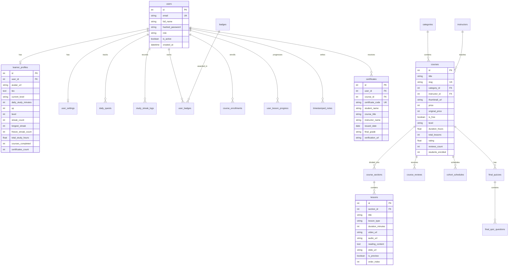

# Sơ Đồ Cơ Sở Dữ Liệu Quan Hệ (Database ERD)

> **Cơ sở dữ liệu:** SQLite 3 với SQLAlchemy 2.0 ORM  
> **Tổng số bảng thực thể:** 14 bảng quan hệ  
> **Dự án:** EduPath Platform - Đồ án UX/UI Nhóm Rise (VKU - GV ThS. Lý Quỳnh Trân)

---

## 1. Sơ đồ Quan hệ Thực thể (Mermaid ERD)

---

## 2. Chi tiết 14 Bảng CSDL

1. **`users`**: Tài khoản người dùng (Email, Password Hash, Họ tên, Role).
2. **`learner_profiles`**: Hồ sơ học viên, chỉ số gamification (XP, Level, Streak, Freeze).
3. **`user_settings`**: Tùy chọn trợ năng (Dark mode, Cỡ chữ, Tự động phát, Giờ nhắc học).
4. **`learning_goals`**: Danh mục mục tiêu học tập (S03).
5. **`interests`**: Danh mục lĩnh vực sở thích (S04).
6. **`placement_questions`**: Ngân hàng câu hỏi trắc nghiệm kiểm tra đầu vào (S07).
7. **`suggested_paths`**: Lộ trình gợi ý cá nhân hóa do hệ thống đề xuất (S09).
8. **`categories`**: Danh mục phân cấp các khóa học (S26).
9. **`instructors`**: Hồ sơ giảng viên, đánh giá và kinh nghiệm (S32).
10. **`courses`**: Bảng dữ liệu khóa học đầy đủ thông số (S25, S27–S30, S34).
11. **`course_sections` & `lessons`**: Cấu trúc chương mục và bài học đa phương tiện (S31, S35–S39).
12. **`daily_quests`**: Nhiệm vụ hàng ngày kèm tiến độ và thưởng XP (S10, S17).
13. **`course_enrollments`**: Quản lý việc ghi danh khóa học và % hoàn thành (S46, S47).
14. **`certificates`**: Chứng chỉ số tốt nghiệp có mã tra cứu chính thức (S47, S48).
