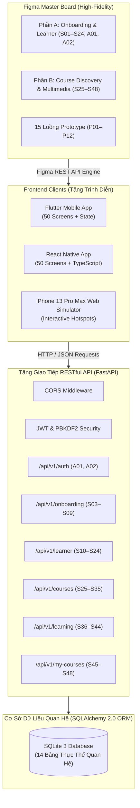

# Kiến Trúc Hệ Thống EduPath (System Architecture)

> **Dự án:** EduPath - Nền tảng học tập thông minh (AI Learning Experience Platform)  
> **Môn học:** Thiết kế UX/UI (1)_TA - Trường ĐH CNTT & TT Việt - Hàn (VKU)  
> **Giảng viên hướng dẫn:** ThS. Lý Quỳnh Trân  
> **Nhóm sinh viên:** Nhóm Rise (Nguyễn Văn Hùng - `23IT.B069`, Nguyễn Gia Minh - `23IT.B132`)

---

## 1. Mô hình Kiến trúc Tổng thể (Overall Architecture)

Hệ thống được thiết kế theo mô hình **Monorepo hiện đại**, phân tầng tách bạch giữa Giao diện người dùng (**Frontend**) và Tầng nghiệp vụ dữ liệu (**Backend**):

---

## 2. Các Phân Hệ Chức Năng Cốt Lõi

### Phân hệ 1: Xác thực & Khảo sát đầu vào (Authentication & Onboarding)
* **Màn hình:** `A01`, `A02`, `S01` – `S09`
* **Mô tả:** Đăng ký, đăng nhập tài khoản học viên, khảo sát mục tiêu (Goal), lĩnh vực quan tâm (Interests), trình độ đầu vào (Level), đặt thời gian học hàng ngày, bài test đánh giá năng lực (Placement Test) và đề xuất lộ trình AI cá nhân hóa.
* **API Routers:** `/api/v1/auth`, `/api/v1/onboarding`

### Phân hệ 2: Trang chủ, Tiến độ & Gamification (Learner Experience)
* **Màn hình:** `S10` – `S24`
* **Mô tả:** Trang chủ học viên tích hợp nhiệm vụ hàng ngày (Daily Quests), chuỗi ngày học liên tục (Streak) với vật phẩm Freeze bảo vệ chuỗi, mục tiêu tuần, thống kê giờ học, hệ thống Level & điểm kinh nghiệm XP, kho huy hiệu danh giá, cây kỹ năng năng lực và các thiết lập trợ năng (Dark mode, font size).
* **API Router:** `/api/v1/learner`

### Phân hệ 3: Khám phá, Tìm kiếm & So sánh Khóa học (Course Catalog)
* **Màn hình:** `S25` – `S35`
* **Mô tả:** Trang khám phá với banner nổi bật, danh mục phân cấp, thanh tìm kiếm thông minh, bộ lọc nâng cao theo giá/sao/thời lượng, chi tiết khóa học, đề cương từng chương, hồ sơ giảng viên, đánh giá học viên và bảng so sánh đa chiều các khóa học.
* **API Router:** `/api/v1/courses`

### Phân hệ 4: Học đa phương tiện & Công cụ hỗ trợ (Multimedia Learning)
* **Màn hình:** `S36` – `S44`
* **Mô tả:** Trình phát bài học hỗ trợ đa định dạng (Video MP4, Audio Podcast, Reading Markdown, Slide PDF), ghi chú gắn mốc giây video (Timestamped Notes), tra cứu từ điển thuật ngữ chuyên ngành (Glossary), quản lý tải xuống ngoại tuyến và chế độ tập trung Pomodoro.
* **API Router:** `/api/v1/learning`

### Phân hệ 5: Học nhóm, Khóa học của tôi & Chứng chỉ số (Cohorts & Exams)
* **Màn hình:** `S45` – `S48`
* **Mô tả:** Lịch học nhóm theo tuần có giảng viên dẫn dắt, danh sách khóa học đang theo học, theo dõi % hoàn thành, bài kiểm tra tốt nghiệp trắc nghiệm cuối khóa và cấp chứng chỉ số có mã xác minh duy nhất.
* **API Router:** `/api/v1/my-courses`
